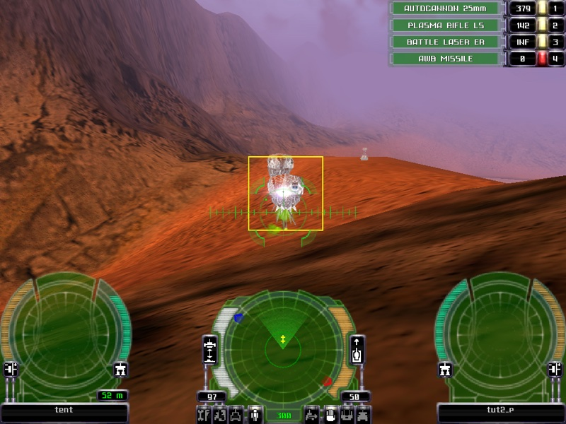
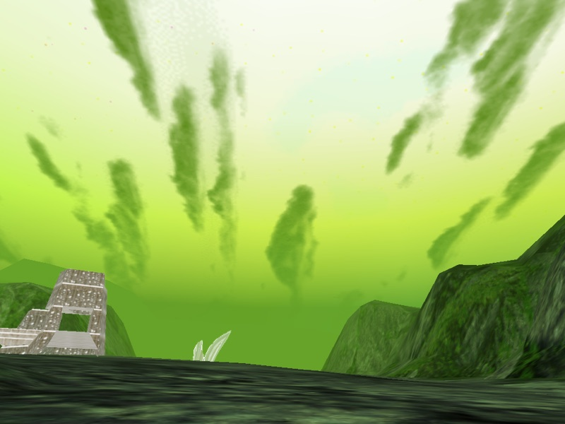
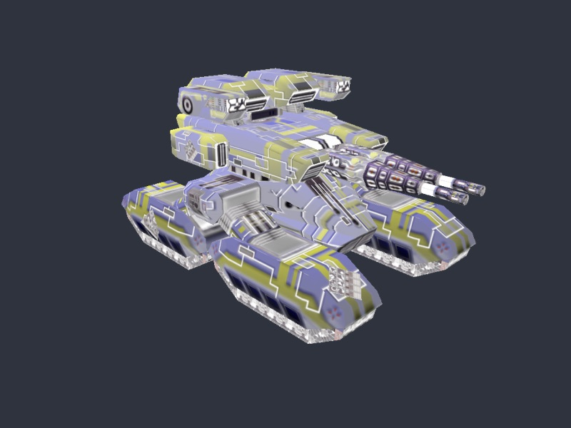
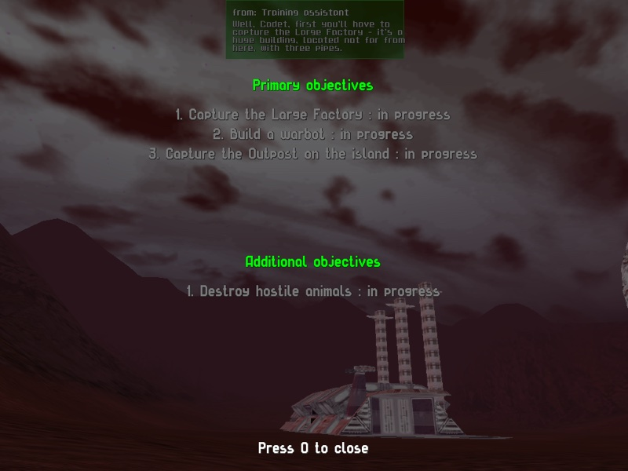

<div align="center">

# Parkan: Iron Strategy — native port

**A from-scratch C++20 / SDL3 reimplementation of *Паркан: Железная стратегия* (Nikita, 2001),
rebuilt from a full decompilation of the original Windows binaries, running natively on macOS.**


<table>
<tr>
<td></td>
<td></td>
</tr>
<tr>
<td></td>
<td></td>
</tr>
</table>

<sub>Rendered by the port from the original GOG data: a fight in Tut_2 with the original cockpit HUD, a Campaign 2 sky,
a warbot assembled from its <code>.dat</code> design, and Tut_2's first message and objectives
(English release).</sub>

</div>

---

## What this is

*Parkan: Iron Strategy* is a Russian 2001 hybrid of real-time strategy and first-person robot
combat. You build a base, design warbots and drive them yourself. It runs on Windows only, on top
of DirectX 7, DirectPlay and a dozen custom engine DLLs.

This repository is a **new engine for the original game data**, in the tradition of OpenMW,
OpenRCT2 and OpenEnroth. You bring the game files from the [GOG release](https://www.gog.com/);
the port reads them as they are and does not modify them.

The port is not guessed from screenshots. Each of the original binaries (`iron3d.dll`, `World3D`,
`Control`, `AniMesh`, `ai`, `Terrain`, `Ngi32` and the rest) was imported into Ghidra, typed,
annotated and decompiled. The resulting notes are the specification. Each port module states
which original function it reproduces, down to the address (`CAniNode::SampleKey` 10012880,
`MWalker::PlanGlobalPath`, …). Original quirks that affect gameplay are kept. Every deliberate
deviation is marked in the code.

It is **not a matching decompilation**: it does not try to recompile into byte-identical DLLs.
The target is behavioural fidelity on a modern platform.

## Status

> Early but playable: you can walk the hero around every campaign map and fight with the original
> cockpit HUD. Guns, bullets, damage, deaths and explosions work, enemy robots engage you, and the
> mission scripts notice your kills. Buildings take damage, burn down and can be captured by walking onto
> their capture lift. Tutorials talk to you and track objectives. There is no base building and no menu
> shell yet.

| Area | State |
|---|---|
| Archives, meshes, textures, materials (NRes, MSH, Texm, MAT0, WEAR) | ✅ every file in the game decodes |
| Terrain (`Land.msh`, all 33 maps) with the original lighting, layers, detail and fog | ✅ |
| Sky domes and time of day (`sky.ske`, 29 skies, 656 layers) | ✅ |
| Missions (TMA): 29 missions, 864 placed objects | ✅ resolve and render |
| Unit designs (`.dat` schemes): 425 designs, 1,279 mounted parts | ✅ |
| Animation and motion graphs (CTLD: 531 entries, 1,690 states) | ✅ sampled like AniMesh |
| Unit physics, ground following, collisions | ✅ motion matches the original simulations exactly |
| Turret aim, cockpit and outer cameras, strafing | ✅ |
| Input: the original binding tables plus a modern WASD layout | ✅ ([controls](docs/CONTROLS.md)) |
| Audio: 399 sounds, effects, 3D positioning, the CD soundtrack | ✅ |
| Unit AI: path search, walker, pilots, migration, attack, follow, target picking, fire control | ✅ (repair and reload tasks to come) |
| Mission scripts: script VM, a strategist AI per clan, 73 handlers | 🟡 61 handlers; enemy clans give patrol and move orders, tutorials send messages and objectives |
| Game text in the game's fonts: message panel, objectives screen (Russian and English) | ✅ |
| Weapons: 158 guns, 66 bullet types, ammo and energy, barrel cycle, sight convergence | ✅ (homing missiles and shields to come) |
| Damage and death: per-part hit points, direct and splash hits, armour, explosions, removal | ✅ |
| Buildings: 167 placed buildings as targets, doors, capture lifts, owner change, the AI capture order | ✅ (building screens, building guns, debris to come) |
| Visual effects: 923 effects (sprites, beams, trails, bursts, debris, lights) | ✅ |
| Cockpit HUD: sight, radar, unit panels, status lamps, weapon rows, lock-on, satellite map | ✅ (targeter 3D view, wingman menu, HUD sounds to come) |
| Base building, research UI, menus, game shell | ⬜ not started |
| Multiplayer (DirectPlay) | ⬜ partly mapped in Ghidra, not ported |

## Quick start

You need macOS on Apple silicon or Intel, Xcode command-line tools and
[Homebrew](https://brew.sh), plus an installed copy of *Parkan: Iron Strategy* from GOG (CrossOver
or Wine is fine just to unpack it). Both GOG releases work:

| Release | GOG build | Notes |
|---|---|---|
| Russian | 2.0.0.4 | the reference build; the later patch (tutorial 4 fix, some research costs) |
| English | 2.0.0.3 | translated text and voices; identical gameplay DLLs |

```sh
brew install cmake ninja sdl3
cmake -S . -B build -G Ninja && cmake --build build
```

The port looks for the game data in this order: the first argument, then `$PARKAN_DATA`, then the
default CrossOver bottle path (`--lang en` picks the English install there). Paths inside the data
are matched case-insensitively.

```sh
export PARKAN_DATA="$HOME/Library/Application Support/CrossOver/Bottles/ParkanIS/drive_c/GOG Games/Parkan - Iron Strategy"
P=build/parkan.app/Contents/MacOS/parkan

$P --play MISSIONS/CAMPAIGN/CAMPAIGN.00/Mission.02      # drive the hero
$P --play MISSIONS/CAMPAIGN/CAMPAIGN.02/Mission.01 --outer 1 --time 20
$P --unit UNITS/AUTO/32_win_l2.dat                       # inspect a unit design
$P --view bases.rlb r_l_01.msh --state 39               # model viewer, motion state 39
$P --terrain DATA/MAPS/Tut_2                             # landscape viewer
```

Useful flags: `--lang en`, `--classic-keys` (the 2001 layout), `--time <s>` (simulate to that time first),
`--no-fog`, `--camera-sway` (the original's walk sway) and `--shot out.bmp` (render one frame
off-screen and exit; this is how visual changes are checked).

### Controls (modern layout)

| | |
|---|---|
| **W A S D** | walk / strafe (half throttle) |
| **Shift** + movement | sprint (full throttle) |
| **Mouse** | turn and aim |
| **Option** + mouse | free look |
| **Space / Ctrl** | up / down (flyers) |
| **C / X** | cruise at full speed / stop |
| **V** | cycle outer cameras · **F10** debug orbit |

The full table, with the original keys next to each command, is in
[`docs/CONTROLS.md`](docs/CONTROLS.md).

## How it was built

```
 GOG install ──► Ghidra (17 binaries) ──► notes/*.md (spec) ──► port/src/<module> ──► checks
   (read-only)     typed, annotated,        one note per          one module per       corpus totals,
                   renamed, decompiled      subsystem             original DLL         unit tests, --shot
```

1. **Decompile.** Each DLL is imported into one Ghidra project and analysed with its imports
   linked across modules. DirectX 7 and hand-written engine types are applied to it. Vtables are
   mapped to classes and functions are named, many from the developers' own error strings.
2. **Specify.** Each subsystem gets a note covering formats, algorithms, constants and addresses
   (rendering, physics, AI, scripts, input, audio, …). These notes, not the decompiler output, are
   what the port is written from.
3. **Reimplement.** Loaders are byte-exact and strict: anything unexpected throws. Their totals
   must match independent Python reference tools.
4. **Verify.** `parkan-check` parses the entire game corpus. `parkan-tests` runs the unit tests,
   compiles every script formula and runs every event of every shipped mission script. Rendering
   changes are checked against off-screen screenshots.

### On being "vibecoded"

Most of the code, the notes and the Ghidra annotations were written by **Claude** (Anthropic's
Opus models in Claude Code), with a human directing the work, testing it and deciding what the
game should feel like. Claude drove Ghidra over MCP, wrote the analysis scripts, read the
decompiled code and ported it, often with several agents working on separate subsystems in
parallel.

The method is meant to keep this honest. Every claim is tied to an address in the original
binary, every loader is checked against the full data corpus, and every visual change is
screenshotted. Where the port departs from the original on purpose, the code says so: the modern
key layout, the stabilised cockpit camera, and Option as a key the original could not see.

## Architecture

The port's modules follow the original DLL boundaries, so each part of the spec has one obvious
place in the code.

| Original binary | Port | Responsibility |
|---|---|---|
| `Ngi32`, `services` | `src/res/`, `src/core/` | NRes archives, textures, meshes, materials, sounds, text |
| `Terrain` | `src/res/terrain`, `src/scene/` | landscape mesh, shading, sky and atmosphere |
| `AniMesh`, `Control` | `src/scene/model`, `src/control/` | skeletal sampling, motion graphs, unit physics, turrets |
| `World3D` | `src/world/`, `src/combat/` | live units, ground probe, collisions, ray traces; guns, bullets, damage, death |
| `Effect` | `src/fx/`, `src/app/fx_draw` | effect templates, the particle runtime and its renderer |
| `ArealMap`, `Behavior`, `Wizard` | `src/ai/` | areas and path search, walkers, pilots, unit behaviour |
| `ai` | `src/ai/script_*`, `formula`, `src/game/` | the mission script VM, the clan strategist (SuperAI), the world model |
| `MisLoad` | `src/mission/` | missions (TMA), unit schemes, research tree, skies |
| `Joystick`, `World3D` input | `src/input/` | scan codes, binding tables, man-manager rules, keymaps |
| Ngi32 sound | `src/audio/` | SDL3 mixer, 3D sound, effects, Ogg music |
| `iron3d` | `src/app/`, `src/ui/` | play mode, viewers, the message panel and objectives screen |

`parkan_core` holds everything except the platform layer and contains no SDL. The renderer uses
SDL_GPU with Metal shaders. More detail is in [`docs/ARCHITECTURE.md`](docs/ARCHITECTURE.md).

```
port/
├── src/            engine: core, res, mission, scene, control, world, combat, fx, ai, game, input, audio, ui, app
├── tools/          parkan-check (corpus), parkan-tests, parkan-dump (inspect any resource)
├── docs/           ARCHITECTURE.md, CONTROLS.md, images/
└── third_party/    stb_vorbis (public domain)
```

## Prior art and neighbours

This project builds on, or sits next to, other work:

**The same game**
- **[FParkan](https://code.popov.link/valentineus/fparkan)** by Valentin Popov
  ([docs](https://fparkan.popov.link), [GitHub mirror](https://github.com/valentineus/fparkan)) is
  the first open project on *Parkan: Iron Strategy*: Rust libraries for the NRes and RsLi archives,
  round-trip validators and Russian format specs. It was the starting map for this work. The port
  confirms most of it and corrects a few points; the corrections are listed in
  `docs/ARCHITECTURE.md`.

**Engine reimplementations that load the original data** (the model this port follows)
- [OpenMW](https://openmw.org) (*Morrowind*), [OpenRCT2](https://github.com/OpenRCT2/OpenRCT2)
  (*RollerCoaster Tycoon 2*), [OpenEnroth](https://github.com/OpenEnroth/OpenEnroth)
  (*Might and Magic VI–VIII*), [fheroes2](https://github.com/ihhub/fheroes2) (*Heroes II*),
  [Julius](https://github.com/bvschaik/julius) (*Caesar III*), [OpenXcom](https://openxcom.org)
  (*UFO / TFTD*).
- [DevilutionX](https://github.com/diasurgical/devilutionX) is the closest in spirit: *Diablo*,
  rebuilt from a reverse-engineered reconstruction of the original code and ported to SDL.

**Matching decompilations** (a different goal: byte-identical rebuilds)
- [n64decomp/sm64](https://github.com/n64decomp/sm64), [zeldaret/oot](https://github.com/zeldaret/oot).

**AI-assisted reverse engineering**
- Chris Lewis, [*The Long Tail of LLM-Assisted Decompilation*](https://blog.chrislewis.au/the-long-tail-of-llm-assisted-decompilation/):
  coding agents on a *Snowboard Kids 2* matching decomp.
- Macabeus, [*Game decompilation using AI*](https://macabeus.medium.com/game-decompilation-using-ai-4d47b65f8852)
  and [*Can LLMs really do matching decompilation?*](https://gambiconf.substack.com/p/can-llms-really-do-matching-decompilation).
- [*Era Online: Resurrecting a 1999 MMORPG with Claude Code*](https://claude.com/es/code-with-claude/session/sf-ext-era-online-resurrecting-a-1999-mmorpg-with-claude-code):
  the same explore → build tools → port loop, applied to a VB6 game.

## Legal

*Parkan: Iron Strategy* and all of its data belong to their rights holders. This repository
contains **no game files**: no binaries, models, textures, sounds, music or text. To run the port
you need a legitimately owned copy of the game. The code is an independent reimplementation for
interoperability and preservation. The screenshots above were rendered by this port from a
purchased GOG copy.

No license has been chosen yet. Until one is, all rights to the port's own code are reserved.

---

<div align="center"><sub>Паркан жив.</sub></div>
